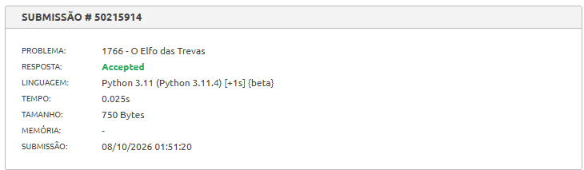

**Problema:** [The Dark Elf](https://judge.beecrowd.com/pt/problems/view/1766)

---

## 📌 Descrição do Problema

> O problema de nome "The Dark Elf" é um problema basicamente de ordenação, em que recebemos como entrada diversas linhas contendo nome, peso, idade e altura de cada uma das renas e devemos dar como saída uma lista de M renas que irão ser selecionadas para puxar o trenó. Essa seleção é baseada inicialmente no peso, então as renas que tiverem os maiores pesos serão escolhidas, no entanto, existe 3 critérios de desempate na seguinte ordem: idade(o mais novo é selecionado), altura(o mais baixo) e, por último, o que tiver primeiro na ordem alfabética.

---

## 💡 Abordagem

> A ideia é basicamente pegar todas as renas e colocar dentro do ranking, ordenar através do método sort, usando os critérios de forma a verificar os atributos na ordem de critério de desempate especificada e a forma de definir se é de modo ascendente ou descendente é básicamente colocar um - na frente do atributo na função para que ele fique decrescente. (Definitivamente não gostei dessa solução, achei muito simples de fazer, acredito que minha ideia inicial era mais interessante, mas acho que a complexidade ficaria maior)

---

## ❌ O Que Não Funcionou

> Inicialmente pensei em talvez descartar direto a rena atual na hora de captar o seu peso, então eu compararia com o peso da última rena do ranking, caso fosse menor, então ela seria automaticamente descartada. No entanto, essa era uma lógica que não tava sendo muito simples de ser feita e também tinha que ficar procurando novamente pelo menor peso dentre as presentes no ranking. Inicialmente pensei que era só colocar que o menor peso do ranking era o peso da nova rena atual, no entanto, a nova rena pode ter o maior peso dentre TODAS do rank, então essa lógica se quebra.

---

## 📊 Análise de Complexidade

### Tempo

> _(Justifique usando notação assintótica. Identifique os loops, recursões ou operações dominantes.)_

### Espaço

> _(Justifique usando notação assintótica. Considere estruturas de dados usadas, recursão, etc.)_

## 🔍 Corretude

> _(Argumente brevemente por que sua solução é correta. Pode ser informal, mas deve ter lógica.)_

---

## 🚀 O Que Poderia ser Melhorado

> _(Reflita: existe solução mais eficiente? O código poderia ser mais legível? Há casos extremos mal tratados?)_

---

## 📸 Evidência de Submissão

> _(Adicione o print do Beecrowd mostrando "Accepted" abaixo)_
> 
